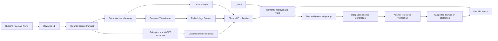

# RAG Knowledge Extractor

A local retrieval-augmented generation (RAG) application over a reproducible
5,200-record subset of the AG News training corpus. It cleans and chunks news
articles, embeds them with Sentence Transformers, stores and retrieves them
with ChromaDB, and can use DeepSeek to generate answers grounded in retrieved
context. Optional LDA topics and VADER sentiment labels can be attached to
documents and used as retrieval filters.

## Features

- Reproducible AG News download, preprocessing, chunking, and dataset checks.
- `sentence-transformers/all-MiniLM-L6-v2` embeddings and persistent ChromaDB
  storage.
- Semantic retrieval, optional topic/sentiment filters, latency benchmarking,
  and manually judged retrieval evaluation.
- Bounded, context-grounded DeepSeek prompts and a separate structured
  answer-to-source verification call; unsupported answers fail closed to an
  abstention.
- LDA topic assignments, VADER sentiment analysis, manual sentiment
  evaluation, and ChromaDB metadata enrichment.
- FastAPI `GET /health` and `POST /query` endpoints with query-free access
  logging and generic client-facing errors.
- Unit tests that mock the LLM and do not require a DeepSeek key or make live
  provider calls.

## Internship scope by week

- **Week 1:** AG News download, preprocessing, environment checks, and corpus
  validation. The current 5,200-record raw subset produces 5,198 documents
  after the unchanged language filter, meeting the 5,000-clean-document
  target.
- **Week 2:** Recursive chunking, sentence-transformer embeddings, persistent
  ChromaDB storage, semantic retrieval, and retrieval benchmarking.
- **Week 3:** DeepSeek client, grounding instructions, distance-based context
  filtering, RAG orchestration, and an LLM-assisted claim-to-source check.
  The verifier is a second call to the same configured model, not an
  independent guarantee; semantic grounding accuracy and successful live
  answer quality remain unmeasured until an authorized live evaluation is run.
- **Week 4:** LDA topic and VADER sentiment outputs, manual sentiment labels,
  ChromaDB metadata enrichment, and optional metadata filters. Preliminary
  script-provided observations are available, but a human must complete and
  retain the generated topic-review template before claiming manual review.
- **Week 5:** FastAPI health/query endpoints, safe request/error logging,
  retrieval metrics, and end-to-end RAG evidence/latency reporting.
- **Week 6:** Reproduction and benchmark documentation. The required exit
  survey is an external manual task and has not been verified here.

## Architecture



The health endpoint does not initialize the RAG pipeline. Retrieval-only
commands do not need a DeepSeek key. Answer generation and source verification
each make a provider API request using the configured model and key.

## Technology and prerequisites

- Windows 10/11 with PowerShell and Python 3.12 (the existing environment was
  verified with Python 3.12.4).
- Direct dependencies are version-pinned in `requirements.txt` (it is not a
  hash-locked transitive dependency file): pandas, NumPy, Pydantic,
  PyArrow, Hugging Face `datasets`, Sentence Transformers, PyTorch, ChromaDB,
  scikit-learn, VADER, langdetect, FastAPI, Uvicorn, HTTPX, python-dotenv,
  spaCy, and pytest.
- Network access for the initial AG News download and the first download of
  the embedding model. CPU inference is supported; CUDA is optional.
- A DeepSeek API key only for live answer generation, the RAG benchmark, and
  end-to-end RAG and semantic grounding evaluation.

The dataset and model can require additional disk space and first-run time.
The project does not download the corpus or call DeepSeek while running tests.

## Setup (PowerShell)

Run commands from the project root. For a new clone, create an environment
once, then install the pinned requirements:

```powershell
Set-Location "C:\path\to\RAG Knowledge Extractor Project"
python -m venv .venv
.\.venv\Scripts\Activate.ps1
python -m pip install -r requirements.txt
python scripts/verify_env.py
```

If PowerShell blocks activation, either adjust the policy for the current user
according to your organization's guidance or invoke the environment
interpreter directly:

```powershell
.\.venv\Scripts\python.exe -m pip install -r requirements.txt
.\.venv\Scripts\python.exe scripts\verify_env.py
```

Do not create another environment or reinstall dependencies when an existing
project-compatible interpreter is already available. Start a fresh PowerShell
session after changing environment variables.

## Configure DeepSeek locally

The client reads `DEEPSEEK_API_KEY` from the process environment or the
project-root `.env` file. Environment variables take precedence. The
`.env.example` file contains placeholders only; `.env` is Git-ignored.

```powershell
Copy-Item .env.example .env
```

Edit `.env` locally and replace the placeholder value. Optional settings are
`DEEPSEEK_MODEL` (default `deepseek-chat`), `DEEPSEEK_BASE_URL` (default
`https://api.deepseek.com`), `DEEPSEEK_TIMEOUT` (default 30 seconds), and
`DEEPSEEK_MAX_OUTPUT_TOKENS` (default 1024). Never put a real key in source
control, documentation, test output, or logs.

## Reproduce the data pipeline

Run these steps from the project root, in order. Generated corpus, model,
vector-store, and report files are local and ignored by Git.

```powershell
# 1. Download 5,200 training articles from fancyzhx/ag_news.
python scripts/download_data.py

# 2. Clean text and validate the output.
python src/preprocessing.py
python scripts/validate_dataset.py

# 3. Split cleaned documents into overlapping chunks.
python src/chunking.py

# 4. Embed chunks; the first run downloads the configured model.
python src/embeddings.py

# 5. Ingest chunk text and vectors into persistent ChromaDB.
python src/vector_store.py

# 6. Optional document-level analysis and metadata enrichment.
python src/topic_modeling.py
python src/sentiment_analysis.py
python scripts/enrich_chroma_metadata.py
python scripts/validate_nlp_metadata.py
```

Defaults use 500-character chunks with 50-character overlap, and
`all-MiniLM-L6-v2` embeddings with dimension 384. Relevant scripts expose
additional options; inspect them with `--help`. Topic and sentiment metadata
are optional and may be regenerated independently before enrichment.
Embedding generation also writes `data/processed/embedding_metadata.json`
with its model name, dimension, chunk count, and SHA-256 fingerprint of chunk
IDs and exact source text. Chroma ingestion requires this manifest, verifies
the fingerprint before touching the collection, and records the model
configuration on the collection.

## Use semantic retrieval

```powershell
python src/retrieval.py "oil prices and the stock market" --top-k 3
python src/retrieval.py "space science news" --top-k 5 --topic-id 9
python src/retrieval.py "company results" --sentiment-label positive
```

Filters can be combined; combined topic and sentiment filters use AND.
Retrieval returns chunk text and a vector distance. A lower distance indicates
a closer vector match; it is not a similarity percentage or relevance score.

## Run the API

Build the corpus, embeddings, and ChromaDB collection first. Then run the
server from the project root:

```powershell
python -m uvicorn src.api:app --host 127.0.0.1 --port 8000
```

Check health:

```powershell
curl.exe http://127.0.0.1:8000/health
```

Submit a query (live generation requires a valid local API key):

```powershell
curl.exe -X POST "http://127.0.0.1:8000/query" `
  -H "Content-Type: application/json" `
  -d '{"query":"What happened in the news?","top_k":5}'
```

The JSON request accepts a non-empty `query`, positive integer `top_k`
(default 5), and optional non-negative `topic_id` and `sentiment_label`
(`negative`, `neutral`, or `positive`). A successful response contains the
answer, retrieved/context chunks, retrieval/generation/verification/total
latency, and `grounding_status` (`supported`, `unsupported`, or
`insufficient_evidence`; `null` when verification was not attempted). The
verifier is instructed to assess factual claims against the context supplied
to generation. Unsupported or insufficient verdicts replace the candidate
text with an abstention. A malformed or unavailable verifier
returns `grounding_status: "unavailable"` and HTTP 502.
Invalid input returns 422; missing local retrieval resources return 503;
upstream timeouts return 504; other known provider failures return 502.
Unexpected failures return a generic 500 response.
There is no separate application-defined 400 response; request-body validation
uses FastAPI's 422 response.

Access logs contain method, endpoint, outcome, status, duration, and a safe
failure category, but not query text, prompts, retrieved content, answers, or
credentials. The API has no authentication or rate limiting and is intended
for local use, not public deployment.

## Tests and evaluation

Run the complete test suite from the project root:

```powershell
python -m pytest -q
```

The latest full local run on Python 3.12.4 passed **267 tests**. It emitted one
Starlette/AnyIO deprecation warning from the installed test-client dependency.
Tests use local fixtures and mocked LLM responses. They do not establish live
DeepSeek availability or successful generation.
Validation used the existing environment: `pip check` passed, but installed
Uvicorn was 0.53.0 while `requirements.txt` pins 0.34.0. The full test suite
ran with the existing version. Separately, the pinned 0.34.0 was installed
into a temporary isolated target and served `GET /health` successfully; the
existing environment was not changed. Direct dependency pins do not lock all
transitive versions or package hashes.

### Retrieval relevance evaluation

Run against the local ChromaDB collection:

```powershell
python scripts/evaluate_retrieval.py --k-values 1 3 5 10
```

The version-controlled `data/labels/retrieval_evaluation_queries.json`
contains 9 queries: 8 with 47 total relevant query/document judgments and 1
unjudged query. The evaluation maps ranked chunks to documents. Duplicate
chunks for one document consume rank positions, while each relevant document
counts at most once per cutoff. Precision@K divides by fixed K; recall@K
divides by the number of manually relevant documents. Results are macro means
over the 8 judged queries.

Saved report: `data/benchmarks/retrieval_evaluation.json`.

| K | Macro Precision@K | Macro Recall@K |
|---:|---:|---:|
| 1 | 0.0000 | 0.0000 |
| 3 | 0.0000 | 0.0000 |
| 5 | 0.0250 | 0.0179 |
| 10 | 0.0625 | 0.0848 |

These low scores apply only to this small, manually labeled sample. The
judgments are incomplete and are not sufficient to establish overall
retrieval quality or compare systems.

### Retrieval performance benchmark

```powershell
python scripts/benchmark_retrieval.py
```

The saved report is `data/benchmarks/retrieval_benchmark.json`. Both the
previously saved run and the Week 6 rerun used 10 queries, 4 `top_k` values,
and 3 repetitions (120 calls). The previously recorded runs measured **13.272
ms** and **12.589 ms** average latency. The latest rerun over the expanded
collection measured **13.212 ms** average, **12.722 ms** median, and
**9.944-38.540 ms** range. The latest post-rebuild measurement is
**14.511 ms** average, **13.718 ms** median, and **9.805-42.085 ms** range.
The timed work is query embedding plus ChromaDB search; model initialization
and benchmark setup are excluded. These machine- and cache-dependent
measurements are not a service-level latency guarantee.

The latest embedding run generated 5,257 vectors in **45.34 seconds** on CPU
at batch size 32 (**115.95 chunks/second**). This local timing is
machine-dependent; the embedding command prints elapsed time and throughput
for each run.

### RAG benchmark and end-to-end evaluation

With a valid API key, both commands send requests to DeepSeek and may incur
provider usage. Without a key, the RAG evaluation records missing-key
failures instead of generating answers. Run these commands only when provider
usage is intended.

```powershell
python scripts/benchmark_rag.py --repetitions 3 --top-k 5
python scripts/evaluate_rag.py --top-k 5
```

The RAG benchmark writes `data/benchmarks/rag_benchmark.json`; the evaluation
writes `data/benchmarks/rag_evaluation.json`. The latest validation rerun
(written to a temporary file, leaving the existing report untouched) had 9
cases: **0 successful, 9 failed**, all due to `missing_api_key`, and no
provider requests or answers were generated. The latest all-attempt
average/median wall times were **51.798 ms / 24.516 ms**. These are failed-run
timings, not successful generation latency. The previous saved report measured
**24.242 ms / 21.497 ms**, also failed-run timings. The context-recall proxy
averaged 0.0179 for 8 judged cases; this measures relevant evidence present in
context, not answer correctness. The
`grounding_status` field is the same configured LLM's structured assessment,
not an independently validated hallucination metric. No successful live LLM
evaluation is claimed.

### Grounding evaluation and what it measures

Run the offline evaluation without credentials:

```powershell
python scripts/evaluate_grounding.py
```

`data/labels/grounding_evaluation_cases.json` contains six manually labeled,
synthetic source/answer examples and eight fixed response-format cases. The
offline command measures precision, recall, accuracy, and error cases for parsing
the fixed verdict-response contract. These protocol metrics measure whether
the code accepts the three permitted JSON verdicts and rejects malformed or
ambiguous responses; they do **not** measure whether an LLM correctly
understands evidence. The response fixtures are mocked, not model outputs.
In the current run the eight protocol fixtures scored accuracy **1.000**,
macro precision **1.000**, macro recall **1.000**, and **0** parser errors.
This is a small contract-conformance result only; it does not represent
semantic verifier precision or recall.

Semantic precision/recall for the six source/answer examples is **not
measured** unless observed verifier outputs are supplied. To score recorded
outputs, pass a JSON file mapping every case ID to an observed verdict
(`supported`, `unsupported`, `insufficient_evidence`, or `error`):

```powershell
python scripts/evaluate_grounding.py --predictions data/labels/grounding_predictions.json
```

No observed predictions are currently included, and the offline command does
not call DeepSeek. A small manually labeled set, even once scored, is not a
guarantee or comprehensive estimate of hallucination detection.

When live provider use is authorized and a key is configured, use the explicit
opt-in mode to call the grounding verifier once for each of the six synthetic
cases and write the recorded verdicts and score to a report:

```powershell
python scripts/evaluate_grounding.py --live `
  --output "$env:TEMP\grounding_live_evaluation.json"
```

The report includes the observed case predictions, provider/model, UTC run
timestamp, semantic confusion matrix and precision/recall, plus sanitized
error types for failed requests. A provider or malformed-verdict failure is
counted as an `error` prediction rather than hidden. This run sends up to six
DeepSeek requests and may incur usage. The checked environment has no
configured key, so semantic results remain unscored here. Alternatively,
record externally observed verdicts in a JSON object with the documented
`case_predictions` mapping and pass it through `--predictions`; predictions
must cover exactly the six labeled case IDs. A saved live-evaluation report
contains that same top-level mapping and can be passed directly to
`--predictions` to reproduce its semantic metrics without another API call.

### Sentiment evaluation

`python src/sentiment_analysis.py` writes the VADER output and
`data/benchmarks/sentiment_evaluation.json`. The available report scores 60
manually labeled articles (20 per class), with accuracy 0.567. Neutral recall
is 0.050:

| Class | Precision | Recall | F1 | Support |
|---|---:|---:|---:|---:|
| Negative | 0.615 | 0.800 | 0.696 | 20 |
| Neutral | 0.500 | 0.050 | 0.091 | 20 |
| Positive | 0.531 | 0.850 | 0.654 | 20 |

The sample is small and curated, not a random estimate of corpus-wide
sentiment quality; VADER scores are not calibrated probabilities.

The NLP metadata validation reports script-provided preliminary observations
for 10 topics and checks metadata-filter behavior. These observations do not
establish topic coherence or represent your approval. To generate a separate
template with each topic's top words, three representative excerpts, and blank
human-review fields, run:

```powershell
python scripts/validate_nlp_metadata.py `
  --output "$env:TEMP\nlp_metadata_validation.json" `
  --topic-review-template "data\benchmarks\lda_topic_review_template.json"
```

Open `data\benchmarks\lda_topic_review_template.json`, compare the top words with the
representative excerpts for **all ten topics**, and fill in
`human_coherence_assessment` and `human_rationale` for each one. Keep
`review_status` as pending until that review is actually complete. The
template-generation command does not make human judgments or update topic
quality metrics. No manually completed review is currently recorded.

## Current artifact sizes and project layout

The regenerated local pipeline artifacts contain 5,200 authentic raw records,
5,198 cleaned documents, 5,257 chunks, 5,257 vectors of dimension 384, and
5,257 records in the `rag_chunks` ChromaDB collection. The existing
language-filtering threshold was not changed. Generated files are local and
may not exist in a fresh checkout.

The latest regeneration produced `data/raw/ag_news_train_5200.jsonl`,
`data/processed/clean_corpus.parquet`, `chunks.parquet`, `embeddings.parquet`,
`embedding_metadata.json`, the LDA topic assignment/summary files, VADER
sentiment scores, and the persistent `rag_chunks` collection. Metadata,
retrieval, RAG, and benchmark reports are regenerated by their corresponding
validation/evaluation commands.

```text
.
├── data/
│   ├── labels/                 # Manual sentiment, retrieval, and grounding labels
│   ├── raw/                    # Downloaded AG News JSONL (ignored)
│   ├── processed/              # Clean corpus, chunks, embeddings, NLP output (ignored)
│   ├── vector_db/              # Persistent ChromaDB store (ignored)
│   └── benchmarks/             # Evaluation and benchmark reports (ignored)
├── scripts/                    # Download, validation, evaluation, and benchmarks
├── src/                        # Preprocessing, retrieval, RAG, API, and NLP modules
├── tests/                      # Unit tests, including mocked LLM/API tests
├── .env.example                # Safe configuration template
├── .gitignore
├── README.md
└── requirements.txt            # Pinned dependencies
```

Important generated files include `data/raw/ag_news_train_5200.jsonl`,
`data/processed/clean_corpus.parquet`, `chunks.parquet`, `embeddings.parquet`,
`embedding_metadata.json`,
`topic_assignments.parquet`, `topic_summary.parquet`,
`sentiment_scores.parquet`, and `data/vector_db/`. Evaluation reports are
written under `data/benchmarks/`. `.gitignore` excludes generated data, local
vector databases, benchmark reports, virtual environments, caches, and `.env`;
the manually curated files in `data/labels/` remain version-controlled.

## Troubleshooting and limitations

- **Missing corpus, model, or collection:** run the pipeline steps above in
  order. The initial dataset/model download needs network access.
- **CPU-only or slow embedding setup:** CPU is supported. Embedding model
  initialization is outside retrieval benchmark timings; first use may be
  substantially slower while the model downloads and loads.
- **Missing API key:** set it in `.env` or the process environment. Retrieval,
  health checks, and tests do not require it; live generation does.
- **API import/startup errors:** activate the intended environment, install
  `requirements.txt` into that environment, and run Uvicorn from the project
  root.
- **Weak retrieval scores:** the evaluation set is small and incomplete, and
  the current measured precision/recall is low. It does not support a claim of
  overall retrieval quality.
- **Grounding verification:** a second call to the same configured LLM is
  instructed to assess answer claims against retrieved sources. It can miss
  unsupported details or incorrectly reject supported claims; it is not
  independent, formally guaranteed, or semantically evaluated on the current
  labeled examples. Prompt instructions alone are not detection. The offline
  evaluation scores response parsing only unless observed model verdicts are
  explicitly supplied.
- **Live grounding evaluation:** `python scripts/evaluate_grounding.py --live`
  is opt-in and makes one verifier request per labeled case (currently six).
  It records actual verdicts, sanitized request-error types, model, timestamp,
  and semantic metrics in the selected output JSON. This can incur provider
  usage. No API key was present in the checked environment, so no live
  evaluation result is currently recorded.
- **Out-of-domain handling:** chunks above cosine distance 0.7 are withheld.
  This heuristic is not calibrated or evaluated as an out-of-domain
  classifier and is separate from answer-to-source verification.
- **Updating ChromaDB:** ordinary ingestion updates records whose document,
  metadata identity, or embedding vector changed, preserves enrichment on
  unchanged records, and deletes IDs absent from current input. Re-run
  topic/sentiment enrichment after changed records are ingested. Embedding
  generation records model/dimension and a fingerprint of the chunk IDs and
  source text in a manifest; ingestion rejects stale manifests before writing
  to Chroma. Re-run `python src/embeddings.py` after any source-text change.
  Chroma stores the model and dimension and rejects mismatches. An existing
  legacy collection without a manifest also requires an explicit rebuild
  before safe adoption.
  After regenerating vectors for a different model or dimension, use
  `python src/vector_store.py --rebuild`; this deletes and recreates only the
  selected collection before ingesting current files. Use `--rebuild` only
  when replacing that collection is intended.
- **NLP quality:** LDA topics can be mixed; VADER can mishandle jargon,
  context, sarcasm, and mixed outcomes. Metadata filter checks establish
  filter behavior, not improved relevance.
- **RAG evaluation:** without a valid key all cases fail before generation;
  the report groups wall-clock latency into all attempts, successful generated
  answers only, and failed attempts only. Do not interpret failed-attempt
  timing as generation latency. Even successful evidence recall would not by
  itself establish answer quality.
- **Deployment:** the API lacks authentication, rate limiting, and production
  hardening. Bind it to localhost unless separately secured.
- **Dependency lock:** `requirements.txt` pins direct dependencies, but does
  not lock the full transitive dependency graph or package hashes. The
  existing environment's Uvicorn version differed from the declared pin;
  the pinned version was smoke-tested in isolation, while the full suite ran
  in the pre-existing environment. Use the documented requirements file for
  direct dependency versions; this is not bit-for-bit environment locking.
